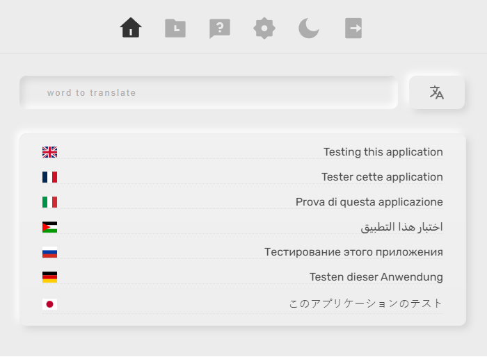
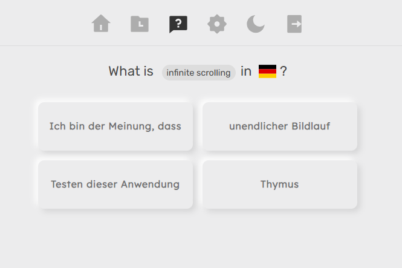
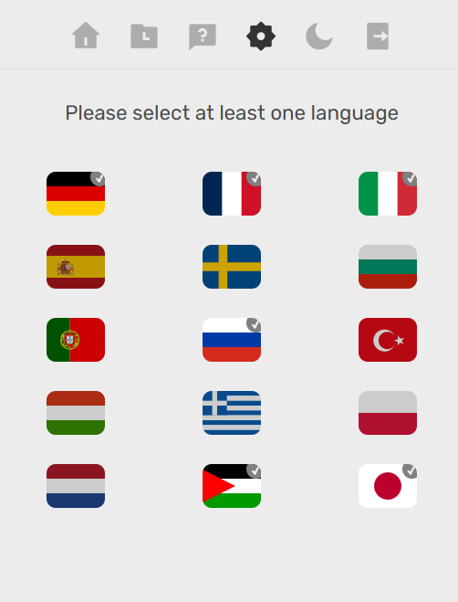

# Persodict

A personal dictionary app. Enter a text once and get translations in several languages at once, keep a history of what you've looked up, and test yourself with a quiz.

## Screenshots

### Translate



### Quiz



### Settings



## Features

- Choose your target languages in Settings
- Translate a text into multiple languages simultaneously (via DeepL)
- Translation history
- Quiz mode for reviewing saved translations
- Email/password, Google sign-in (NextAuth)
- Light and dark themes with micro-animations

## Tech stack

Next.js (Pages Router) · TypeScript · styled-components · Framer Motion · NextAuth · Prisma + MongoDB · SWR · Cypress

## Getting started

**Prerequisites:** Node 24.x, Yarn, a MongoDB database, and a [DeepL API](https://www.deepl.com/pro-api) key.

```bash
git clone https://github.com/aghyadallogie/Persodict
cd Persodict
yarn install        # also runs `prisma generate`
# create .env.local (see below)
yarn dev            # http://localhost:3000
```

### Environment variables

Create `.env.local`:

| Variable                                    | Purpose                                           |
| ------------------------------------------- | ------------------------------------------------- |
| `DATABASE_URL`                              | MongoDB connection string                         |
| `NEXTAUTH_URL`                              | Public app URL (e.g. `http://localhost:3000`)     |
| `NEXTAUTH_SECRET`                           | NextAuth signing secret                           |
| `JWT_SECRET`                                | JWT signing secret                                |
| `NEXT_APP_DEEPL_AUTH_KEY`                   | DeepL API key                                     |
| `GOOGLE_CLIENT_ID` / `GOOGLE_CLIENT_SECRET` | Google OAuth credentials                          |

## Scripts

| Command        | Description                          |
| -------------- | ------------------------------------ |
| `yarn dev`     | Start the dev server                 |
| `yarn build`   | Production build                     |
| `yarn start`   | Serve the production build           |
| `yarn lint`    | Run ESLint                           |
| `yarn test`    | Run Cypress component tests          |
| `yarn release` | Bump version and update the changelog (`standard-version`) |

## Architecture

The app follows a hexagonal ("ports and adapters") approach that keeps logic out of the UI by using custom hooks.

```
src/
├── client/
│   ├── domain/        # entities and adapters
│   ├── application/   # use cases and services
│   ├── context/       # theme context
│   └── ui/            # components, modules, layouts, styles
├── server/            # controllers, services, domain, utils
├── pages/             # Next.js routes and API routes (auth, home, history, quiz, settings)
└── middleware.ts
database/schema.prisma # Prisma schema
cypress/               # component tests
```

## Contributing

1. Fork the repo and create a branch: `git checkout -b feature/your-feature`
2. Make your changes; run `yarn lint` and `yarn test`
3. Commit using [Conventional Commits](https://www.conventionalcommits.org/) (e.g. `feat: add quiz filter`)
4. Open a pull request

## License

No license file is currently included in the repository.
